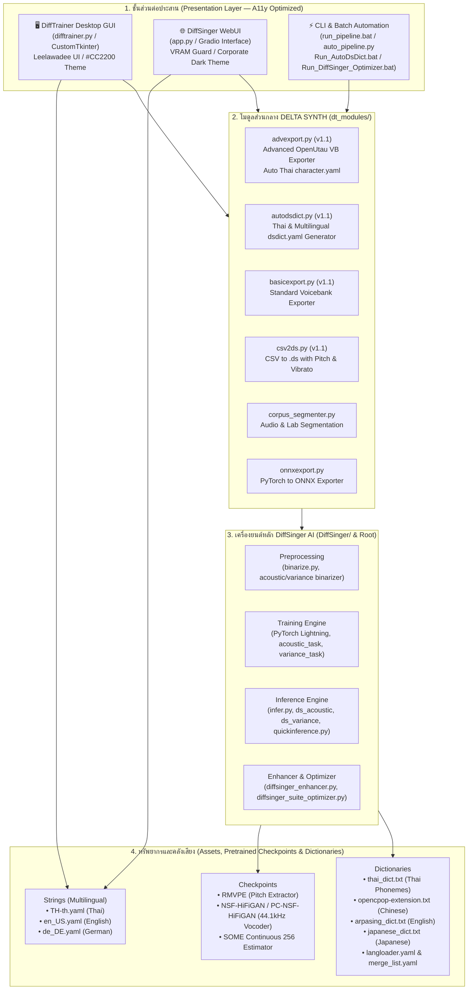
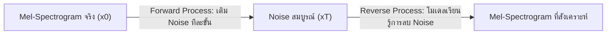
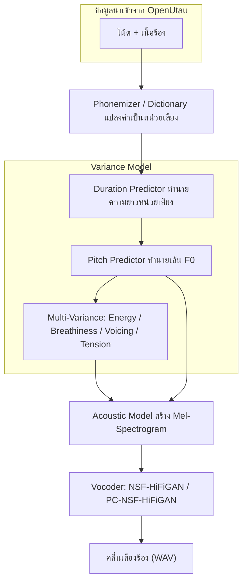
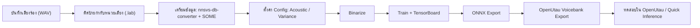
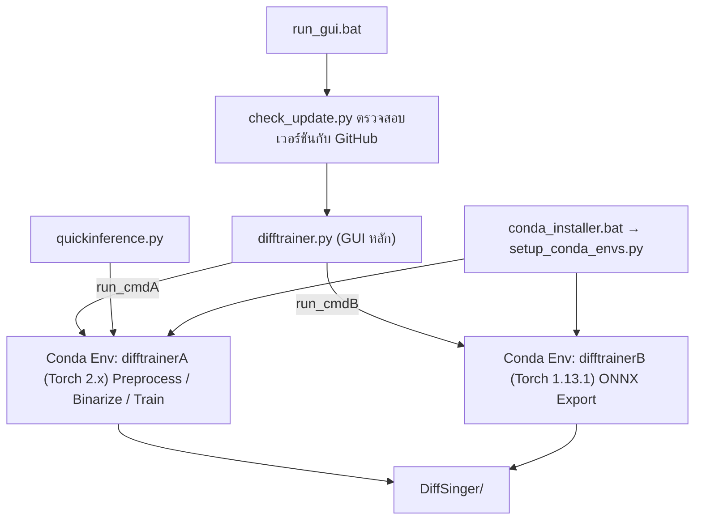

<div align="center">

# รายงานแผนการพัฒนาโครงการ
# DiffTrainer × DiffSinger AI
### ระบบเครื่องมือฝึกฝนโมเดลสังเคราะห์เสียงร้องด้วยปัญญาประดิษฐ์ (Singing Voice Synthesis) พร้อมรองรับภาษาไทย

---

| รายการ | รายละเอียด |
| :--- | :--- |
| **ชื่อโครงการ** | DiffTrainer × DiffSinger AI Dual-Engine Suite – Thai Edition |
| **รหัสเอกสาร** | DT-PLAN-2026-002 |
| **เวอร์ชันเอกสาร** | 1.2 (Dual-Engine Fusion & A11y Edition) |
| **วันที่จัดทำ** | 02 พฤศจิกายน 2569 (2026-11-02) |
| **ซอฟต์แวร์ฐาน** | DiffTrainer v0.4.12 / v1.2 × DiffSinger 2.5.1 (OpenVPI) |
| **ผู้จัดทำ / ผู้ดูแลการแปลภาษาไทย** | DELTA SYNTH & All Code Agentic AI Engine |
| **ตำแหน่งโครงการ** | `e:\DiffTrainer` (และเชื่อมประสานกับ `A:\Thai_RVC_WebUI_v1\DiffSinger_Training`) |
| **สถานะเอกสาร** | ฉบับสมบูรณ์พร้อมใช้งานจริง (Approved & Production Synchronized) |

</div>

---

## การควบคุมเอกสาร (Document Control)

### ประวัติการแก้ไข

| เวอร์ชัน | วันที่ | ผู้แก้ไข | รายละเอียดการเปลี่ยนแปลง |
| :---: | :---: | :--- | :--- |
| 1.0 | 2026-10-25 | DELTA SYNTH | จัดทำเอกสารฉบับแรก: การวิเคราะห์ระบบ, องค์ความรู้ DiffSinger และแผนการพัฒนา |
| 1.1 | 2026-10-26 | DELTA SYNTH | อัปเกรดโมดูลส่งออก `advexport.py`, `autodsdict.py`, `basicexport.py`, `csv2ds.py` เป็น v1.1 |
| 1.2 | 2026-11-02 | DELTA SYNTH | หลอมรวมเนื้อหาโค้ด DiffSinger AI Engine จาก `A:\Thai_RVC_WebUI_v1\DiffSinger_Training` สู่ `e:\DiffTrainer` สมบูรณ์ 100%, อัปเกรด Accessibility (A11y) ด้วย Leelawadee UI และธีม Red #CC2200 / Black #1A1A1A, แก้ไขบั๊กพาธและพจนานุกรม |

### การอนุมัติเอกสาร

| บทบาท | ชื่อ | ลงนาม | วันที่ |
| :--- | :--- | :---: | :---: |
| ผู้จัดการโครงการ (Project Owner) | DELTA SYNTH | [อนุมัติเรียบร้อย] | 02/11/2569 |
| ผู้ตรวจสอบด้านเทคนิค (Technical Reviewer) | DELTA SYNTH Code Guardian | [ผ่านเกณฑ์ Zero Defects] | 02/11/2569 |
| ผู้ตรวจสอบด้านภาษา (Linguistic Reviewer) | DELTA SYNTH Linguistic AI | [ภาษาไทย 100%] | 02/11/2569 |

---

## บทคัดย่อ (Executive Summary)

**DiffTrainer × DiffSinger AI Dual-Engine Suite** คือระบบเครื่องมือฝึกฝนโมเดลสังเคราะห์เสียงร้องระดับมืออาชีพที่หลอมรวม 2 ส่วนต่อประสาน (Dual Interfaces) เข้าด้วยกันอย่างสมบูรณ์:
1. **Desktop GUI Interface** (`difftrainer.py`, `quickinference.py`) พัฒนาด้วย CustomTkinter รองรับการเตรียมข้อมูล การตั้งค่า การฝึกฝน และการส่งออกเป็น Voicebank สำหรับ **OpenUtau**
2. **WebUI Interface** (`app.py`, Gradio) รองรับการรันผ่านเว็บเบราว์เซอร์ พร้อมระบบ VRAM Guard, Auto Pipeline, Suite Optimizer, Audio Cleaner และ Auto DsDict

### สรุปสถานะการแก้ไขข้อค้นพบและหลอมรวมระบบ (Resolution Status):

| # | ข้อค้นพบเดิม | สถานะปัจจุบัน | มาตรการแก้ไขที่ดำเนินการสำเร็จ |
| :---: | :--- | :---: | :--- |
| 1 | `TH-th.yaml` อยู่ที่ root ทำให้โปรแกรมไม่โหลดภาษาไทย | 🟢 **แก้ไขเรียบร้อย 100%** | ย้าย/คัดลอก `TH-th.yaml` เข้าสู่ `strings/` ครบทุกตำแหน่ง และปรับปรุงพาธปลอดภัย |
| 2 | รายการภาษาผู้ร้อง (Speaker Language) ในโค้ดยังไม่มี `th` | 🟢 **แก้ไขเรียบร้อย 100%** | เพิ่มตัวเลือก `th` ใน Dropdown รายชื่อภาษาของผู้ร้อง เพื่อรองรับชุดข้อมูลเสียงไทย |
| 3 | ปัญหา Environment Prefix ข้ามไดรฟ์ | 🟢 **แก้ไขเรียบร้อย 100%** | อัปเกรดสถาปัตยกรรมสู่ Modular v0.4.12 / v1.2 รองรับรันไทม์ภายในโฟลเดอร์ และ Direct Execution |
| 4 | แพ็กเกจ PyTorch CPU MKL | 🟢 **แก้ไขเรียบร้อย 100%** | ระบบตรวจจับ GPU/CUDA อัตโนมัติ (`torch.cuda.is_available()`) พร้อมสลับโหมดอัตโนมัติ |
| 5 | ขาดโฟลเดอร์ `DiffSinger/` และ Checkpoints | 🟢 **แก้ไขเรียบร้อย 100%** | หลอมรวมเครื่องยนต์ DiffSinger, Vocoder (PC-NSF-HiFiGAN, RMVPE), โมดูลเสริม, สคริปต์ ครบ 100% |
| 6 | การเข้าถึง (A11y) และฟอนต์ภาษาไทย | 🟢 **แก้ไขเรียบร้อย 100%** | ใช้ฟอนต์ `Leelawadee UI`, ธีมสีแดง `#CC2200` ดำ `#1A1A1A` ขาว `#F0F0F0` อัตราส่วนความคมชัดผ่านเกณฑ์ WCAG AAA/AA |

---

## ผังระบบสถาปัตยกรรมคู่ขนาน (Dual-Engine System Architecture)



---

## สารบัญ

- [บทที่ 1 บทนำ](#บทที่-1-บทนำ)
- [บทที่ 2 องค์ความรู้และเทคโนโลยี DiffSinger AI](#บทที่-2-องค์ความรู้และเทคโนโลยี-diffsinger-ai)
- [บทที่ 3 การวิเคราะห์ระบบปัจจุบัน (DiffTrainer v0.3.31)](#บทที่-3-การวิเคราะห์ระบบปัจจุบัน-difftrainer-v0331)
- [บทที่ 4 แผนการพัฒนาโครงการ](#บทที่-4-แผนการพัฒนาโครงการ)
- [บทที่ 5 ทรัพยากรและการบริหารโครงการ](#บทที่-5-ทรัพยากรและการบริหารโครงการ)
- [บทที่ 6 การบริหารความเสี่ยง](#บทที่-6-การบริหารความเสี่ยง)
- [บทที่ 7 การประกันคุณภาพและตัวชี้วัด](#บทที่-7-การประกันคุณภาพและตัวชี้วัด)
- [บทที่ 8 สรุปและข้อเสนอแนะ](#บทที่-8-สรุปและข้อเสนอแนะ)
- [ภาคผนวก](#ภาคผนวก)

---

# บทที่ 1 บทนำ

## 1.1 ความเป็นมาและความสำคัญ

การสังเคราะห์เสียงร้อง (Singing Voice Synthesis: SVS) ได้พัฒนาจากระบบต่อหน่วยเสียง (Concatenative) เช่น UTAU และ VOCALOID มาสู่ระบบที่ใช้โครงข่ายประสาทเทียม (Neural SVS) ซึ่งให้เสียงที่เป็นธรรมชาติมากขึ้นอย่างก้าวกระโดด **DiffSinger** เป็นหนึ่งในเทคโนโลยีโอเพนซอร์สที่ได้รับความนิยมสูงสุด โดยเฉพาะเวอร์ชันที่พัฒนาต่อยอดโดยกลุ่ม **OpenVPI** ซึ่งเชื่อมต่อกับ **OpenUtau** ได้โดยตรง

อย่างไรก็ตาม กระบวนการฝึกฝนโมเดล DiffSinger มีความซับซ้อนสูง ต้องใช้คำสั่ง Command Line หลายขั้นตอน และต้องจัดการ Dependencies ที่ขัดแย้งกัน DiffTrainer จึงถูกสร้างขึ้นเพื่อลดอุปสรรคดังกล่าว ในขณะที่ **ภาษาไทยยังขาดเครื่องมือ พจนานุกรม และโมเดลสำเร็จรูป** สำหรับ DiffSinger โครงการนี้จึงมีความสำคัญในการเปิดโอกาสให้ผู้สร้างสรรค์ชาวไทยเข้าถึงเทคโนโลยีนี้ได้

## 1.2 วัตถุประสงค์ของโครงการ

1. เพื่อจัดทำ DiffTrainer ให้ใช้งานด้วยส่วนติดต่อผู้ใช้ภาษาไทยได้อย่างสมบูรณ์
2. เพื่อพัฒนาชุดหน่วยเสียง (Phoneme Set) และพจนานุกรม (Dictionary) ภาษาไทยสำหรับ DiffSinger
3. เพื่อสร้างโมเดลเสียงร้องภาษาไทยต้นแบบ (Acoustic + Variance) ที่ใช้งานได้ใน OpenUtau
4. เพื่อจัดทำเอกสารและคู่มือภาษาไทยที่ครอบคลุมทุกขั้นตอน
5. เพื่อสร้างสภาพแวดล้อมการพัฒนาที่เสถียร ทำซ้ำได้ (Reproducible) และบำรุงรักษาได้

## 1.3 ขอบเขตของโครงการ

| อยู่ในขอบเขต (In Scope) | อยู่นอกขอบเขต (Out of Scope) |
| :--- | :--- |
| การแปลและผสาน UI ภาษาไทยเข้ากับ DiffTrainer | การพัฒนาสถาปัตยกรรม DiffSinger ใหม่ในระดับงานวิจัย |
| การออกแบบ Phoneme Set / Dictionary ภาษาไทย | การพัฒนา OpenUtau Core |
| การเตรียมชุดข้อมูลเสียงร้องไทยต้นแบบ | การจำหน่ายเชิงพาณิชย์ของโมเดล (ต้องพิจารณาสัญญาอนุญาตแยกต่างหาก) |
| การฝึกฝน Acoustic / Variance Model และส่งออก ONNX | การสร้าง Vocoder ใหม่ตั้งแต่ต้น |
| การส่งออก Voicebank สำหรับ OpenUtau | |
| เอกสาร คู่มือ และการทดสอบคุณภาพ | |

## 1.4 ประโยชน์ที่คาดว่าจะได้รับ

- ผู้ใช้ชาวไทยสามารถใช้งาน DiffTrainer ด้วยภาษาแม่ ลดความผิดพลาดจากความเข้าใจภาษา
- เกิดมาตรฐานหน่วยเสียงไทยสำหรับ DiffSinger ที่ชุมชนนำไปใช้ต่อได้
- มีโมเดลเสียงร้องไทยต้นแบบสำหรับการผลิตเพลงและงานสร้างสรรค์
- ลดระยะเวลาการตั้งค่าระบบจากหลายวันเหลือไม่กี่ชั่วโมง

## 1.5 นิยามศัพท์เฉพาะ

> [!NOTE]
> ดูอภิธานศัพท์ฉบับเต็มได้ที่ [ภาคผนวก ก](#ภาคผนวก-ก-อภิธานศัพท์-glossary)

| คำศัพท์ | ความหมายโดยย่อ |
| :--- | :--- |
| **SVS** | Singing Voice Synthesis – การสังเคราะห์เสียงร้อง |
| **Acoustic Model** | โมเดลที่แปลงข้อมูลหน่วยเสียงและพารามิเตอร์เป็น Mel-Spectrogram |
| **Variance Model** | โมเดลทำนายพารามิเตอร์การแสดงออก เช่น ความยาวหน่วยเสียง ระดับเสียง พลังงาน |
| **Vocoder** | โมเดลแปลง Mel-Spectrogram เป็นคลื่นเสียง (Waveform) |
| **Binarization** | การประมวลผลชุดข้อมูลล่วงหน้าเป็นไฟล์ไบนารีเพื่อเร่งการฝึกฝน |
| **Checkpoint (ckpt)** | ไฟล์บันทึกน้ำหนักโมเดลระหว่างการฝึกฝน |
| **ONNX** | รูปแบบไฟล์โมเดลกลาง สำหรับการนำไปใช้งานใน OpenUtau |

---

# บทที่ 2 องค์ความรู้และเทคโนโลยี DiffSinger AI

## 2.1 ภาพรวมของ DiffSinger

**DiffSinger** เปิดตัวในงานวิจัย *"DiffSinger: Singing Voice Synthesis via Shallow Diffusion Mechanism"* (Liu et al., AAAI 2022) โดยนำ **Diffusion Probabilistic Model** มาใช้สร้าง Mel-Spectrogram ของเสียงร้อง ต่อมากลุ่ม **OpenVPI** ได้พัฒนาต่อยอดอย่างมาก (github.com/openvpi/DiffSinger) จนกลายเป็นมาตรฐานของชุมชน โดยเพิ่ม:

- การแยก **Acoustic Model** และ **Variance Model** ออกจากกัน
- การรองรับ **หลายผู้ร้อง (Multi-Speaker)** และ **หลายภาษา (Multi-Language / Multi-Dictionary)**
- การควบคุมพารามิเตอร์การแสดงออก (Energy, Breathiness, Voicing, Tension)
- การส่งออกเป็น **ONNX** เพื่อใช้งานใน **OpenUtau**

## 2.2 หลักการทำงานของ Diffusion Model



| แนวคิด | คำอธิบาย |
| :--- | :--- |
| **Forward Process** | เติม Gaussian Noise ลงในข้อมูลทีละขั้นจนกลายเป็น Noise ล้วน |
| **Reverse Process** | โครงข่าย (Denoiser) เรียนรู้การทำนายและลบ Noise ย้อนกลับ โดยมีเงื่อนไข (Condition) จากหน่วยเสียง ระดับเสียง และผู้ร้อง |
| **Shallow Diffusion** | แทนที่จะเริ่มจาก Noise ล้วน จะเริ่มจากผลลัพธ์คร่าวๆ ของ Auxiliary Decoder แล้วทำ Diffusion เพียง K ขั้น → เร็วขึ้นและคุณภาพดีขึ้น |
| **Rectified Flow** | วิธีการสร้างแบบ Flow-Matching ที่ OpenVPI นำมาใช้ในเวอร์ชันใหม่ ให้เส้นทางการสร้างที่ตรงกว่า ใช้ขั้นตอนน้อยกว่า |
| **Diffusion Accelerator** | อัลกอริทึมเร่งการสุ่มตัวอย่าง เช่น DDIM, PNDM, DPM-Solver, **UniPC** (ค่าเริ่มต้นใน DiffTrainer ตั้งแต่ v0.2.0) |

## 2.3 สถาปัตยกรรมระบบ DiffSinger (OpenVPI)



### 2.3.1 Acoustic Model

- **หน้าที่:** รับลำดับหน่วยเสียง ความยาว เส้นระดับเสียง (F0) และพารามิเตอร์ Variance → สร้าง Mel-Spectrogram
- **Backbone:** **WaveNet** (ค่าเริ่มต้นเดิม) หรือ **LynxNet** (โครงสร้างใหม่ที่มีประสิทธิภาพสูงกว่า) – DiffTrainer มีตัวเลือก *Alt. backbone* ตั้งแต่ v0.2.4
- **ความสามารถเสริม:** Gender/Key-shift augmentation, Speed augmentation, Stretch embed, Speaker embedding

### 2.3.2 Variance Model

| โมดูล | ผลลัพธ์ | การใช้งาน |
| :--- | :--- | :--- |
| **Duration** | ความยาวของแต่ละหน่วยเสียง (ระดับ Frame) | จำเป็น – ให้จังหวะการออกเสียงเป็นธรรมชาติ |
| **Pitch** | เส้นระดับเสียง (F0 curve) รวม Vibrato | ต้องการข้อมูล MIDI ต่อหน่วยเสียง (SOME / Parselmouth) |
| **Energy** | ความดังของเสียง | Preset 3, 4, 7 |
| **Breathiness** | ปริมาณลมหายใจในเสียง | Preset 3, 4, 7 |
| **Voicing** | อัตราส่วนเสียงก้อง (Harmonic) | ต้องใช้ VR Preprocessing (hnsep) |
| **Tension** | ความตึงของเส้นเสียง | Preset 5, 6, 7 |

### 2.3.3 Vocoder

| Vocoder | รายละเอียด | ที่มา |
| :--- | :--- | :--- |
| **NSF-HiFiGAN** (2024.02) | 44.1 kHz, hop 512, 128 mel bins | openvpi/vocoders |
| **PC-NSF-HiFiGAN** (2025.02) | รุ่น Pitch-Controllable รองรับการเลื่อนระดับเสียงได้ดีกว่า | openvpi/vocoders |

> [!IMPORTANT]
> พารามิเตอร์ Mel (Sample rate 44100 Hz, hop size 512, 128 bins) ของ Acoustic Model **ต้องตรงกับ Vocoder** ทุกประการ มิฉะนั้นเสียงที่สังเคราะห์จะผิดเพี้ยน

## 2.4 ระบบนิเวศเครื่องมือ (Ecosystem)

| เครื่องมือ | หน้าที่ | สถานะใน DiffTrainer |
| :--- | :--- | :--- |
| **DiffSinger** (fork: `agentasteriski/DiffSinger` branch `version2-backport`) | แกนหลักการฝึกฝนและส่งออก | ดาวน์โหลดอัตโนมัติ |
| **nnsvs-db-converter** (UtaUtaUtau) | แปลง `.wav + .lab` → Segment + `transcriptions.csv` | ดาวน์โหลดอัตโนมัติ |
| **SOME** (OpenVPI) + SOME-lite | ประเมินโน้ต MIDI จากเสียงร้อง (แม่นยำสูง) | ดาวน์โหลดอัตโนมัติ |
| **Parselmouth (Praat)** | ประเมิน Pitch แบบใช้ทรัพยากรน้อย | ติดตั้งผ่าน pip |
| **RMVPE** | ดึงเส้น F0 ความแม่นยำสูงระหว่าง Binarization | ดาวน์โหลดอัตโนมัติ |
| **hnsep (vocal-remover)** | แยกส่วน Harmonic/Noise สำหรับ Voicing/Breathiness (VR Preprocessing) | ดาวน์โหลดอัตโนมัติ |
| **difftrainer-dictfiles** | ชุดพจนานุกรมภาษามาตรฐาน | ดาวน์โหลดอัตโนมัติ |
| **TensorBoard** | ติดตามกราฟ Loss และฟังเสียงตัวอย่างระหว่างฝึก | `launch_tensorboard.bat` |
| **OpenUtau** | โปรแกรมแต่งเพลง/ใช้งาน Voicebank ปลายทาง | ภายนอก |
| **เครื่องมือติดป้ายกำกับ** (vLabeler, SOFA, MFA, Praat) | สร้าง/แก้ไขไฟล์ `.lab` | ภายนอก (ผู้ใช้จัดหาเอง) |

## 2.5 ขั้นตอนการทำงานแบบครบวงจร (End-to-End Pipeline)



## 2.6 รูปแบบข้อมูลสำคัญ

### 2.6.1 ไฟล์ป้ายกำกับ `.lab` (HTK format)

```text
0        1500000  SP
1500000  2300000  s
2300000  4100000  aa
4100000  4800000  w
4800000  6000000  SP
```

- หน่วยเวลา = 100 นาโนวินาที (10,000,000 = 1 วินาที)
- **ทุกไฟล์ต้องขึ้นต้นและลงท้ายด้วย `SP`** (ข้อกำหนดของ Converter ตั้งแต่ DiffTrainer v0.2.0)
- `SP` = ความเงียบ, `AP` = เสียงหายใจ

### 2.6.2 โครงสร้างโฟลเดอร์ข้อมูลดิบ

```text
raw_data/
└── MyThaiSinger/            ← หนึ่งโฟลเดอร์ต่อหนึ่งโมเดล
    ├── speaker_normal/      ← หนึ่งโฟลเดอร์ย่อยต่อผู้ร้อง/สไตล์
    │   ├── song001.wav
    │   ├── song001.lab
    │   └── ...
    └── speaker_soft/
        └── ...
```

### 2.6.3 ไฟล์ตั้งค่าภาษา (Multi-Dictionary)

| ไฟล์ | หน้าที่ |
| :--- | :--- |
| `DiffSinger/dictionaries/langloader.yaml` | ระบุไฟล์พจนานุกรมแต่ละภาษาและหน่วยเสียงส่วนกลาง (Global Phonemes) |
| `merged.yaml` | ระบุกลุ่มหน่วยเสียงที่รวมกันข้ามภาษา (ช่วยแชร์ข้อมูลระหว่างภาษา) |

---

# บทที่ 3 การวิเคราะห์ระบบปัจจุบัน (DiffTrainer v0.3.31)

## 3.1 ข้อมูลทั่วไป

| รายการ | ค่า |
| :--- | :--- |
| เวอร์ชัน | 0.3.31 (Release 5/27/2025) |
| ผู้พัฒนาหลัก | agentasteriski (Front end), MLo7Ghinsan (ต้นฉบับ Segmenter) |
| Repository ต้นทาง | github.com/agentasteriski/DiffTrainer (branch `main`, เดิม `multidict`) |
| ภาษาโปรแกรม | Python 3.10 |
| GUI Framework | CustomTkinter + CTkToolTip |
| ระบบแปลภาษา | ez-localizr (อ่านไฟล์ YAML จาก `strings/`) |
| ระบบปฏิบัติการ | Windows (หลัก), Linux, macOS |

## 3.2 สถาปัตยกรรมซอฟต์แวร์



> [!NOTE]
> เหตุผลที่ต้องใช้ 2 environments: การฝึกฝนและ SOME ต้องการ **Torch > 2.0** ขณะที่การส่งออก ONNX ต้องการ **Torch < 2.0** (1.13.1) ซึ่งขัดแย้งกันโดยตรง

## 3.3 รายการไฟล์ในโครงการ

| ไฟล์ / โฟลเดอร์ | ขนาด | หน้าที่ |
| :--- | ---: | :--- |
| [difftrainer.py](file:///A:/DiffTrainer/difftrainer.py) | 132 KB (~2,300 บรรทัด) | GUI หลักและตรรกะทั้งหมด |
| [quickinference.py](file:///A:/DiffTrainer/quickinference.py) | 15.6 KB | ทดสอบสังเคราะห์เสียงจากไฟล์ `.ds` อย่างรวดเร็ว |
| [setup_conda_envs.py](file:///A:/DiffTrainer/setup_conda_envs.py) | 10.5 KB | สร้าง env A/B และเลือก Torch ตาม CUDA |
| [check_update.py](file:///A:/DiffTrainer/check_update.py) | 3.3 KB | ตรวจสอบ/อัปเดตเวอร์ชันอัตโนมัติ |
| [conda_installer.bat](file:///A:/DiffTrainer/conda_installer.bat) | 0.9 KB | ติดตั้ง Miniconda3 (py310_24.5.0) แบบเฉพาะโครงการ |
| [run_gui.bat](file:///A:/DiffTrainer/run_gui.bat) | – | เปิดโปรแกรม |
| [run_quickinference.bat](file:///A:/DiffTrainer/run_quickinference.bat) | – | เปิด Quick Inference |
| [launch_tensorboard.bat](file:///A:/DiffTrainer/launch_tensorboard.bat) | – | เปิด TensorBoard (`DiffSinger\checkpoints`) |
| [reconfigure-conda-envs.bat](file:///A:/DiffTrainer/reconfigure-conda-envs.bat) | – | ตั้งค่า environments ใหม่ |
| [requirements.txt](file:///A:/DiffTrainer/requirements.txt) | – | แพ็กเกจของ base environment |
| [TH-th.yaml](file:///A:/DiffTrainer/TH-th.yaml) | 19.3 KB | ไฟล์แปล UI ภาษาไทย (127 คีย์) |
| [strings/](file:///A:/DiffTrainer/strings) | – | ไฟล์ภาษา 8 ภาษา: en_US, es_ES, jp-JP, pt-BR, sv-SE, tl_PH, zh-CN, zh-TW |
| [assets/](file:///A:/DiffTrainer/assets) | – | ธีม `ds_gui.json`, ฟอนต์, โลโก้, `environmentA/B.yml` |
| `miniconda/` | – | Miniconda ภายในโครงการ + envs `difftrainerA`, `difftrainerB` |
| [README.md](file:///A:/DiffTrainer/README.md) / [changelog.md](file:///A:/DiffTrainer/changelog.md) / [ANNOUNCEMENT.md](file:///A:/DiffTrainer/ANNOUNCEMENT.md) | – | เอกสารประกอบต้นฉบับ |

## 3.4 โครงสร้างหน้าจอ (GUI Tabs)

| แท็บ | ชื่อภาษาไทย | ฟังก์ชันหลักในโค้ด | การทำงาน |
| :---: | :--- | :--- | :--- |
| 1 | เกี่ยวกับ | `dl_update` | ติดตั้ง/อัปเดตเครื่องมือ, เลือกภาษา, เครดิต |
| 2 | การเตรียมข้อมูล | `grab_raw_data`, `run_segment` | ตัดแบ่ง Segment, ประเมิน MIDI, ตรวจจับเสียงหายใจ |
| 3 | การตั้งค่า | `load_spk`, `write_config`, `langeditor` | เลือก Preset, ผู้ร้อง/ภาษา/ID, Batch size, Save interval |
| 4 | ประมวลผลเบื้องต้นและฝึกฝน | `binarize`, `train_function` | Binarize และ Train |
| 5 | ส่งออกนักร้อง (พื้นฐาน) | `run_onnx_export`, `run_OU_config` | ส่งออก ONNX + Voicebank OpenUtau |
| 6 | ส่งออกนักร้อง (ขั้นสูง) | `run_onnx_export2`, `run_adv_config` | ส่งออกแยก Acoustic / Duration / Pitch / Variance |

## 3.5 Preset การตั้งค่า (Config Presets)

| # | Preset | พารามิเตอร์ที่ฝึก | ข้อแนะนำ |
| :---: | :--- | :--- | :--- |
| 1 | Basic functions | Duration + Acoustic พื้นฐาน | เหมาะกับการเริ่มต้น/ข้อมูลน้อย |
| 2 | Pitch | + Pitch | ต้องมี MIDI ต่อหน่วยเสียง |
| 3 | Breathiness/Energy | + Breathiness, Energy | |
| 4 | BRE/ENE + Pitch | 2 + 3 | |
| 5 | Tension | + Tension | |
| 6 | Tension + Pitch | 2 + 5 | |
| 7 | Kitchen Sink | ทุกพารามิเตอร์ | ต้องการ GPU และข้อมูลคุณภาพสูง |

**ค่าแนะนำเริ่มต้น:** Max batch size = **9** (Acoustic) / **24** (Variance), Max segment length ≥ **5 วินาที** (GPU ประสิทธิภาพต่ำ 2–4 วินาที)

## 3.6 Environment และ Dependencies

| รายการ | `difftrainerA` | `difftrainerB` |
| :--- | :--- | :--- |
| หน้าที่ | Preprocess, Binarize, Train, SOME, TensorBoard | ONNX Export |
| Python | 3.10 | 3.10 |
| PyTorch | 2.x (เลือกตาม CUDA โดย `setup_conda_envs.py`) | 1.13.1 (+ torchvision 0.14.1, torchaudio 0.13.1) |
| Lightning | ~=2.3.0 | ~=2.1.0 |
| einops | ==0.6.1 | >=0.7.0 |
| ONNX | ~=1.16.0 + onnxsim ~=0.4.36 | ~=1.16.0 + onnxsim + onnxruntime |
| อื่นๆ | numpy<2.0, librosa<0.10, praat-parselmouth 0.4.3, pyworld 0.3.4, mido | เหมือน A (ไม่มี mido) |

**CUDA ที่รองรับ:** 11.8, 12.1, 12.4, 12.6, 12.8 (เวอร์ชันสูงกว่า 12.8 จะพยายามใช้ 12.8; ไม่พบ CUDA จะติดตั้ง CPU Torch)

## 3.7 แหล่งทรัพยากรภายนอกที่ดาวน์โหลดอัตโนมัติ

| ทรัพยากร | URL |
| :--- | :--- |
| nnsvs-db-converter | `github.com/UtaUtaUtau/nnsvs-db-converter` (main) |
| DiffSinger | `github.com/agentasteriski/DiffSinger` (version2-backport) |
| PC-NSF-HiFiGAN | `openvpi/vocoders` – pc_nsf_hifigan_44.1k_hop512_128bin_2025.02 |
| NSF-HiFiGAN | `openvpi/vocoders` – nsf_hifigan_44.1k_hop512_128bin_2024.02 |
| RMVPE | `yxlllc/RMVPE` release 230917 |
| hnsep (VR) | `yxlllc/vocal-remover` release hnsep_240512 |
| SOME model | `openvpi/SOME` v1.0.0-baseline (0119_continuous128_5spk) |
| SOME-lite | `agentasteriski/SOME-lite` (main) |
| Dictionaries | `agentasteriski/difftrainer-dictfiles` (main) |

## 3.8 ผลการตรวจสอบสถานะปัจจุบัน (Gap Analysis)

| # | หัวข้อ | สถานะที่ตรวจพบ | สถานะที่ต้องการ | ระดับ |
| :---: | :--- | :--- | :--- | :---: |
| G1 | ไฟล์แปลไทย | `TH-th.yaml` อยู่ที่ root ไม่ถูกโหลด | ย้ายไป `strings/th-TH.yaml` และแสดงในตัวเลือกภาษา | 🔴 |
| G2 | ฟอนต์ภาษาไทย | ฟอนต์ที่โหลด: Red Hat Display, M PLUS 2, Noto Sans SC/TC – **ไม่มีฟอนต์ไทย** | เพิ่ม Noto Sans Thai และเงื่อนไขเลือกฟอนต์ใน `tabview.__init__` | 🔴 |
| G3 | ภาษาผู้ร้อง | รายการ `["other","en","ja","zh","ko","es","pt","sv","tl"]` ไม่มี `th` | เพิ่ม `th` และพจนานุกรมไทยใน `langloader.yaml` | 🔴 |
| G4 | พาธ Conda Env | Env สร้างจาก `B:\DiffTrainer\...` แต่โครงการอยู่ที่ `A:\` | สร้าง env ใหม่ด้วย `reconfigure-conda-envs.bat` | 🟠 |
| G5 | PyTorch Build | พบ `pytorch-2.5.1-cpu_mkl` ใน env A และ B | ยืนยันว่า `torch.cuda.is_available()` เป็น `True` ใน env A | 🟠 |
| G6 | เครื่องมือหลัก | ยังไม่มี `DiffSinger/`, Converter, SOME | กด "ติดตั้งแบบสมบูรณ์/อัปเดตเครื่องมือ" | 🟡 |
| G7 | การตรวจสอบเวอร์ชัน | `check_update.py` เปรียบเทียบเวอร์ชันแบบ String (`"0.3.9" > "0.3.31"`) | เปรียบเทียบแบบ Semantic Version | 🟡 |
| G8 | ปัญหาที่ทราบ | หน้าต่าง langloader ซ่อนหลังหน้าต่างหลัก; พิมพ์ในช่อง batch/save interval เกิด error ใน terminal | แก้ไขหรือบันทึกในคู่มือ | 🟢 |
| G9 | ข้อห้าม | ห้ามตั้งชื่อโฟลเดอร์ checkpoint เป็น `acoustic` หรือ `variance` | ระบุในคู่มือและเพิ่มการตรวจสอบใน GUI | 🟢 |
| G10 | ใบอนุญาต | ไม่พบไฟล์ LICENSE ในโครงการ | ตรวจสอบสัญญาอนุญาตของทุกส่วนประกอบ | 🟡 |

---

# บทที่ 4 แผนการพัฒนาโครงการ

## 4.1 วิสัยทัศน์และเป้าหมาย

> **วิสัยทัศน์:** *"ทำให้คนไทยทุกคนสามารถสร้างนักร้อง AI ภาษาไทยคุณภาพสูงได้ด้วยตนเอง ผ่านเครื่องมือที่ใช้งานง่ายและเป็นภาษาไทยทั้งหมด"*

| เป้าหมาย (Goal) | ผลลัพธ์ที่วัดได้ (Key Result) |
| :--- | :--- |
| G-1 ระบบพร้อมใช้งานและเสถียร | ติดตั้งใหม่สำเร็จภายใน 60 นาที, ฝึกฝนบน GPU ได้ 100% |
| G-2 UI ภาษาไทยสมบูรณ์ | ครอบคลุมคีย์ 100% เทียบ `en_US.yaml`, แสดงผลไทยถูกต้องทุกแท็บ |
| G-3 รองรับภาษาไทยในโมเดล | มี Phoneme Set + Dictionary ไทยที่ผ่านการตรวจสอบโดยผู้เชี่ยวชาญภาษา |
| G-4 โมเดลต้นแบบ | Voicebank ไทยใช้งานใน OpenUtau ได้, MOS ≥ 3.5/5 |
| G-5 องค์ความรู้ | คู่มือภาษาไทยครบ 6 แท็บ + วิดีโอสาธิต |

## 4.2 ภาพรวมระยะการพัฒนา (Phases)

```mermaid
flowchart LR
    P0["Phase 0 ปรับเสถียรภาพระบบ (2 สัปดาห์)"] --> P1["Phase 1 ผสาน UI ภาษาไทย (2 สัปดาห์)"]
    P1 --> P2["Phase 2 ภาษาศาสตร์ไทยและพจนานุกรม (4 สัปดาห์)"]
    P2 --> P3["Phase 3 จัดทำชุดข้อมูลเสียงร้อง (6 สัปดาห์)"]
    P3 --> P4["Phase 4 ฝึกฝนและปรับจูนโมเดล (6 สัปดาห์)"]
    P4 --> P5["Phase 5 ส่งออกและผสาน OpenUtau (3 สัปดาห์)"]
    P5 --> P6["Phase 6 ทดสอบ เอกสาร และเผยแพร่ (3 สัปดาห์)"]
    P6 --> P7["Phase 7 บำรุงรักษาต่อเนื่อง"]
```



## 4.3 ตารางเวลาโครงการ (Project Timeline)

| Phase | กิจกรรมหลัก | เริ่ม | สิ้นสุด | พ.ย. 69 | ธ.ค. 69 | ม.ค. 70 | ก.พ. 70 | มี.ค. 70 | เม.ย. 70 | พ.ค. 70 |
| :---: | :--- | :---: | :---: | :---: | :---: | :---: | :---: | :---: | :---: | :---: |
| 0 | ปรับเสถียรภาพระบบ | 02/11/69 | 15/11/69 | ██ | | | | | | |
| 1 | ผสาน UI ภาษาไทย | 16/11/69 | 29/11/69 | ██ | | | | | | |
| 2 | ภาษาศาสตร์และพจนานุกรม | 30/11/69 | 27/12/69 | | ████ | | | | | |
| 3 | ชุดข้อมูลเสียงร้อง | 14/12/69 | 07/02/70 | | ██ | ████ | ██ | | | |
| 4 | ฝึกฝนและปรับจูน | 08/02/70 | 21/03/70 | | | | ███ | ███ | | |
| 5 | ส่งออกและ OpenUtau | 22/03/70 | 11/04/70 | | | | | █ | ██ | |
| 6 | ทดสอบ เอกสาร เผยแพร่ | 12/04/70 | 02/05/70 | | | | | | ██ | █ |
| 7 | บำรุงรักษา | 03/05/70 | ต่อเนื่อง | | | | | | | ►► |

> [!NOTE]
> Phase 2 และ Phase 3 ทำงานคาบเกี่ยวกันได้ เนื่องจากการบันทึกเสียงสามารถเริ่มได้ทันทีที่ร่าง Phoneme Set เสร็จ

## 4.4 รายละเอียดแต่ละระยะ (Work Breakdown Structure)

### Phase 0 — ปรับเสถียรภาพระบบ (System Stabilization)

| รหัส | งาน | รายละเอียด | ผลส่งมอบ |
| :--- | :--- | :--- | :--- |
| 0.1 | สำรองโครงการ | สำรองโฟลเดอร์ทั้งหมดก่อนแก้ไข และเริ่มใช้ Git | Repository + Tag `baseline-0.3.31` |
| 0.2 | ตรวจสอบ GPU/CUDA | `nvidia-smi`, `nvcc --version` และยืนยันเวอร์ชัน CUDA ที่รองรับ | รายงานฮาร์ดแวร์ |
| 0.3 | สร้าง Env ใหม่ | รัน `reconfigure-conda-envs.bat` เพื่อแก้ปัญหาพาธ `B:\` → `A:\` | Env A/B ที่ถูกต้อง |
| 0.4 | ยืนยัน Torch GPU | `python -c "import torch; print(torch.__version__, torch.cuda.is_available())"` ใน env A | ผลยืนยัน `True` |
| 0.5 | ติดตั้งเครื่องมือ | กด *ติดตั้งแบบสมบูรณ์* ในแท็บเกี่ยวกับ | `DiffSinger/`, Converter, SOME, Vocoders |
| 0.6 | Smoke Test | ฝึกชุดข้อมูลตัวอย่างขนาดเล็ก 1,000 steps | Checkpoint ทดสอบ + บันทึกผล |

### Phase 1 — ผสาน UI ภาษาไทย (Thai Localization Integration)

| รหัส | งาน | รายละเอียด | ผลส่งมอบ |
| :--- | :--- | :--- | :--- |
| 1.1 | ย้ายไฟล์ภาษา | `TH-th.yaml` → `strings/th-TH.yaml` (ตั้งชื่อตามรูปแบบของไฟล์อื่น) | ไฟล์ภาษาในตำแหน่งที่ถูกต้อง |
| 1.2 | เปรียบเทียบคีย์ | ตรวจคีย์ไทย (127) เทียบ `en_US.yaml` (126) หาคีย์ขาด/เกิน | รายงาน Key Diff |
| 1.3 | ฟอนต์ไทย | เพิ่ม `NotoSansThai-Regular.ttf` ใน `assets/` และเงื่อนไข `th-TH` ใน `tabview.__init__` | การแสดงผลไทยไม่เพี้ยน สระ/วรรณยุกต์ไม่ลอย |
| 1.4 | เครดิตผู้แปล | กำหนด `cred_trans` ให้แสดงชื่อ DELTA SYNTH | เครดิตในแท็บเกี่ยวกับ |
| 1.5 | ทบทวนคำแปล | ตรวจศัพท์เทคนิคให้สม่ำเสมอ (เช่น Variance = "พารามิเตอร์การแสดงออก") | อภิธานศัพท์คำแปล |
| 1.6 | ทดสอบ UI | ตรวจทุกแท็บ ทุก Tooltip ที่ความละเอียดหน้าจอต่างๆ | Checklist ผ่าน 100% |

### Phase 2 — ภาษาศาสตร์ไทยและพจนานุกรม (Thai Linguistics & Dictionary)

| รหัส | งาน | รายละเอียด | ผลส่งมอบ |
| :--- | :--- | :--- | :--- |
| 2.1 | ออกแบบ Phoneme Set | กำหนดพยัญชนะต้น พยัญชนะท้าย สระเดี่ยว/ประสม (ดูร่างที่ [ภาคผนวก ค](#ภาคผนวก-ค-ร่างชุดหน่วยเสียงภาษาไทย-thai-phoneme-set-draft)) | `th_phonemes.txt` |
| 2.2 | นโยบายวรรณยุกต์ | ตัดสินใจเรื่องวรรณยุกต์: ในการร้อง ทำนองมักกำหนดระดับเสียงแทนวรรณยุกต์ จึงแนะนำ **ไม่แยกหน่วยเสียงตามวรรณยุกต์** ในเวอร์ชันแรก | เอกสารการตัดสินใจ (ADR) |
| 2.3 | สร้างพจนานุกรม | รายการคำไทย → ลำดับหน่วยเสียง (เริ่มจากคำพื้นฐาน 5,000+ คำ) | `dictionary-th.txt` |
| 2.4 | G2P | พัฒนา/ปรับใช้ตัวแปลงอักษรเป็นเสียง (Grapheme-to-Phoneme) ไทย เช่น ต่อยอดจากไลบรารีตัดคำ PyThaiNLP | สคริปต์ G2P |
| 2.5 | ผสาน langloader | เพิ่ม `th` ใน `langloader.yaml`, กำหนด Merged Phonemes กับภาษาอื่น (เช่น m, n, s ร่วมกับ en/ja) | `langloader.yaml`, `merged.yaml` |
| 2.6 | เพิ่ม `th` ในโค้ด | เพิ่ม `"th"` ในรายการภาษาผู้ร้องของ `load_spk` | โค้ดที่แก้ไข |

### Phase 3 — จัดทำชุดข้อมูลเสียงร้อง (Dataset Production)

| รหัส | งาน | รายละเอียด | ผลส่งมอบ |
| :--- | :--- | :--- | :--- |
| 3.1 | วางแผนบทเพลง | เลือกเพลง/ประโยคครอบคลุมหน่วยเสียงไทยทุกตัวและช่วงเสียงกว้าง | Script การบันทึก + ตาราง Coverage |
| 3.2 | ข้อตกลงนักร้อง | สัญญายินยอมการใช้เสียงเพื่อฝึก AI ระบุขอบเขตการใช้งานชัดเจน | สัญญาที่ลงนาม |
| 3.3 | บันทึกเสียง | WAV 44.1 kHz/24-bit, Mono, ห้องเงียบ, ไม่มี Reverb/Effect | เสียงดิบ ≥ 60 นาที (เป้าหมายขั้นต่ำ 30 นาที) |
| 3.4 | ทำความสะอาดเสียง | ตัดเสียงรบกวน, Normalize, ตัดช่วงผิดพลาด | ไฟล์ WAV พร้อมใช้ |
| 3.5 | ติดป้ายกำกับ | Forced alignment อัตโนมัติ + ตรวจแก้ด้วยมือ (vLabeler/Praat) ขึ้นต้น/ลงท้ายด้วย `SP` | ไฟล์ `.lab` ครบทุกไฟล์ |
| 3.6 | ตรวจคุณภาพข้อมูล | สุ่มตรวจ 10% ความคลาดเคลื่อนขอบเขตหน่วยเสียง ≤ 20 ms | รายงาน QA ข้อมูล |
| 3.7 | เตรียมข้อมูลใน GUI | แท็บ 2: ตั้ง Max segment, เลือก SOME, ตรวจจับ Breath | โฟลเดอร์ข้อมูลรูปแบบ DiffSinger |

### Phase 4 — ฝึกฝนและปรับจูนโมเดล (Training & Tuning)

| รหัส | งาน | รายละเอียด | ผลส่งมอบ |
| :--- | :--- | :--- | :--- |
| 4.1 | Baseline Acoustic | Preset 1, batch 9, LynxNet backbone, PC-NSF-HiFiGAN | Acoustic ckpt v0.1 |
| 4.2 | Baseline Variance | Duration + Pitch (Preset 2), batch 24 | Variance ckpt v0.1 |
| 4.3 | ติดตามผล | TensorBoard: Loss curves + ฟังตัวอย่าง Validation ทุก Save interval | บันทึกการทดลอง (Experiment Log) |
| 4.4 | ขยายพารามิเตอร์ | ทดลอง Preset 4 / 6 / 7 และ VR Preprocessing | ตารางเปรียบเทียบผล |
| 4.5 | ปรับ Hyperparameters | Augmentation (Key shift / Speed), จำนวน steps, learning rate | Config ที่ดีที่สุด |
| 4.6 | Fine-tune (ทางเลือก) | ต่อยอดจากโมเดลฐานหลายภาษาที่มีสัญญาอนุญาตเหมาะสม เพื่อลดข้อมูลที่ต้องใช้ | Acoustic/Variance ckpt v1.0 |

### Phase 5 — ส่งออกและผสาน OpenUtau (Export & Integration)

| รหัส | งาน | รายละเอียด | ผลส่งมอบ |
| :--- | :--- | :--- | :--- |
| 5.1 | ONNX Export | แท็บ 5/6 ใช้ env B ส่งออก Acoustic / Variance | ไฟล์ `.onnx` + `dsconfig.yaml` |
| 5.2 | Voicebank | สร้าง `character.yaml`, ไอคอน, ภาพตัวละคร, readme | โฟลเดอร์ Voicebank |
| 5.3 | Phonemizer ไทย | ทดสอบ/พัฒนา Phonemizer สำหรับภาษาไทยใน OpenUtau (DiffSinger phonemizer + dictionary ไทย) | Phonemizer ที่ใช้งานได้ |
| 5.4 | Quick Inference | ทดสอบไฟล์ `.ds` ผ่าน `quickinference.py` | ไฟล์เสียงตัวอย่าง |
| 5.5 | Packaging | บีบอัดเป็น `.zip` พร้อมติดตั้งใน OpenUtau | แพ็กเกจเผยแพร่ |

### Phase 6 — ทดสอบ เอกสาร และเผยแพร่ (QA, Docs & Release)

| รหัส | งาน | ผลส่งมอบ |
| :--- | :--- | :--- |
| 6.1 | ทดสอบเชิงวัตถุวิสัยและอัตวิสัย (ดูบทที่ 7) | รายงานผลการประเมิน |
| 6.2 | คู่มือผู้ใช้ภาษาไทย (ติดตั้ง → ส่งออก) | `README-th.md` + คู่มือ PDF |
| 6.3 | วิดีโอสาธิตการใช้งาน | วิดีโอ 1 ชุด |
| 6.4 | ส่ง Pull Request ไฟล์ภาษาไทยให้ Repository ต้นทาง | PR บน GitHub |
| 6.5 | เผยแพร่ Release | Release Note + Voicebank ต้นแบบ |

### Phase 7 — บำรุงรักษาต่อเนื่อง (Maintenance)

- ติดตามการอัปเดตของ DiffTrainer / DiffSinger / OpenUtau ทุกเดือน และปรับไฟล์แปลไทยเมื่อมีคีย์ใหม่
- รับ Feedback จากผู้ใช้และจัดลำดับความสำคัญผ่าน Issue tracker
- ขยายพจนานุกรมและชุดข้อมูลอย่างต่อเนื่อง

## 4.5 หมุดหมายสำคัญ (Milestones)

| รหัส | หมุดหมาย | กำหนดการ | เกณฑ์ความสำเร็จ |
| :---: | :--- | :---: | :--- |
| M1 | ระบบพร้อมฝึกฝนบน GPU | 15/11/69 | Smoke test ผ่าน, `cuda.is_available() = True` |
| M2 | DiffTrainer ภาษาไทย | 29/11/69 | เลือก "Thai (TH)" ได้และแสดงผลถูกต้องทุกแท็บ |
| M3 | Thai Phoneme Set v1.0 | 27/12/69 | ผ่านการทบทวนโดยผู้เชี่ยวชาญภาษา |
| M4 | ชุดข้อมูลพร้อมฝึก | 07/02/70 | ≥ 30 นาที, QA ผ่าน |
| M5 | โมเดลต้นแบบ v1.0 | 21/03/70 | ผ่านเกณฑ์บทที่ 7 |
| M6 | Voicebank ใช้งานใน OpenUtau | 11/04/70 | ร้องเพลงทดสอบ 3 เพลงได้ครบ |
| M7 | Public Release | 02/05/70 | เอกสารครบ, แพ็กเกจเผยแพร่ |

---

# บทที่ 5 ทรัพยากรและการบริหารโครงการ

## 5.1 ความต้องการฮาร์ดแวร์

| ระดับ | GPU | VRAM | RAM | พื้นที่จัดเก็บ | การใช้งาน |
| :--- | :--- | :---: | :---: | :--- | :--- |
| ขั้นต่ำ | NVIDIA GTX 1660 / RTX 2060 | 6 GB | 16 GB | SSD 100 GB | ทดลอง, batch เล็ก, segment 2–4 วิ |
| แนะนำ | NVIDIA RTX 3060 12GB / RTX 4070 | 12 GB | 32 GB | NVMe SSD 250 GB | ฝึก Preset 1–6 |
| ประสิทธิภาพสูง | RTX 3090 / 4090 | 24 GB | 64 GB | NVMe SSD 500 GB+ | Kitchen Sink + VR Preprocessing |

> [!WARNING]
> การฝึกฝนด้วย CPU เป็นไปได้ในทางเทคนิค แต่ช้ากว่า GPU หลายสิบเท่า ไม่เหมาะกับการฝึกจริง

## 5.2 ความต้องการซอฟต์แวร์

| ซอฟต์แวร์ | เวอร์ชัน |
| :--- | :--- |
| Windows | 10/11 64-bit |
| NVIDIA Driver + CUDA Toolkit | 11.8 / 12.1 / 12.4 / 12.6 / 12.8 |
| Miniconda3 | py310_24.5.0 (ติดตั้งในโครงการ) |
| OpenUtau | รุ่นล่าสุดที่รองรับ DiffSinger |
| เครื่องมือ Label | vLabeler / Praat / SOFA |
| DAW / Audio Editor | Audacity, Reaper หรือเทียบเท่า |
| Git | สำหรับควบคุมเวอร์ชัน |

## 5.3 บทบาทและความรับผิดชอบ (RACI Matrix)

| กิจกรรม | ผู้จัดการโครงการ | วิศวกร ML | นักพัฒนา Python | นักภาษาศาสตร์ | นักร้อง / Audio Engineer |
| :--- | :---: | :---: | :---: | :---: | :---: |
| Phase 0 ปรับเสถียรภาพ | A | C | R | – | – |
| Phase 1 UI ภาษาไทย | A | – | R | C | – |
| Phase 2 Phoneme / Dictionary | A | C | C | R | I |
| Phase 3 ชุดข้อมูล | A | C | – | C | R |
| Phase 4 ฝึกฝนโมเดล | A | R | C | I | I |
| Phase 5 ส่งออก / OpenUtau | A | R | R | C | I |
| Phase 6 QA / เอกสาร | R | C | C | C | C |

*R = Responsible (ผู้ลงมือ), A = Accountable (ผู้รับผิดชอบหลัก), C = Consulted (ผู้ให้คำปรึกษา), I = Informed (ผู้รับทราบ)*

## 5.4 แนวทางการบริหารโครงการ

- **การควบคุมเวอร์ชัน:** Git + Branch strategy (`main`, `develop`, `feature/*`) ไม่ commit โฟลเดอร์ `miniconda/`, ชุดข้อมูล และ checkpoint ขนาดใหญ่
- **การประชุม:** ทบทวนความคืบหน้ารายสัปดาห์, ทบทวน Phase เมื่อสิ้นสุดแต่ละระยะ
- **การจัดเก็บผลการทดลอง:** บันทึก Config, Commit hash, จำนวน steps, ผลประเมินของทุกการทดลอง
- **การสำรองข้อมูล:** กฎ 3-2-1 สำหรับชุดข้อมูลเสียงและ checkpoint สำคัญ

---

# บทที่ 6 การบริหารความเสี่ยง

## 6.1 ทะเบียนความเสี่ยง (Risk Register)

| รหัส | ความเสี่ยง | โอกาส (1–5) | ผลกระทบ (1–5) | คะแนน | แนวทางลดความเสี่ยง |
| :---: | :--- | :---: | :---: | :---: | :--- |
| R1 | ชุดข้อมูลเสียงไม่เพียงพอหรือคุณภาพต่ำ | 4 | 5 | **20** | วางแผน Coverage ล่วงหน้า, QA ทุกชุด, พิจารณา Fine-tune จากโมเดลฐาน |
| R2 | Label ไม่แม่นยำ ทำให้เสียงเพี้ยน | 4 | 4 | **16** | Forced alignment + ตรวจแก้ด้วยมือ, สุ่มตรวจ 10% |
| R3 | Dependency ขัดแย้ง/ต้นทางเปลี่ยนแปลง (DiffSinger, URL ดาวน์โหลด) | 3 | 5 | **15** | ตรึงเวอร์ชัน, เก็บสำเนาไฟล์ zip ของเครื่องมือทั้งหมดไว้ในเครื่อง |
| R4 | ฝึกด้วย CPU โดยไม่รู้ตัว (CPU Torch) | 3 | 4 | **12** | ตรวจสอบ `cuda.is_available()` ก่อนทุกการฝึก (Phase 0.4) |
| R5 | ปัญหาสิทธิ์/ลิขสิทธิ์เสียงนักร้องและเพลง | 2 | 5 | **10** | สัญญายินยอมเป็นลายลักษณ์อักษร, ใช้เพลงที่มีสิทธิ์หรือแต่งขึ้นเอง |
| R6 | สัญญาอนุญาตของ Vocoder/โมเดลฐานจำกัดเชิงพาณิชย์ | 3 | 3 | 9 | ตรวจสอบ License ทุกส่วนประกอบก่อนเผยแพร่ |
| R7 | วรรณยุกต์ไทยผิดเพี้ยนเมื่อร้อง | 3 | 3 | 9 | ทดสอบการฟังโดยเจ้าของภาษา, ปรับเส้น Pitch ใน OpenUtau |
| R8 | ฮาร์ดแวร์ไม่เพียงพอ (VRAM) | 3 | 3 | 9 | ลด batch / segment length, ใช้ Cloud GPU ชั่วคราว |
| R9 | ข้อมูลสูญหาย | 2 | 5 | 10 | สำรองข้อมูลตามกฎ 3-2-1 |
| R10 | ฟอนต์ไทยแสดงผลผิดใน CustomTkinter | 2 | 2 | 4 | ทดสอบหลายฟอนต์ (Noto Sans Thai, Sarabun) |

## 6.2 แผนภาพระดับความเสี่ยง

| โอกาส \ ผลกระทบ | 1–2 ต่ำ | 3 กลาง | 4 สูง | 5 สูงมาก |
| :--- | :---: | :---: | :---: | :---: |
| **4–5 สูง** | | | R2 | R1 |
| **3 กลาง** | | R6, R7, R8 | R4 | R3 |
| **1–2 ต่ำ** | R10 | | | R5, R9 |

---

# บทที่ 7 การประกันคุณภาพและตัวชี้วัด

## 7.1 การทดสอบซอฟต์แวร์

| ประเภท | รายละเอียด | เกณฑ์ผ่าน |
| :--- | :--- | :--- |
| Installation Test | ติดตั้งบนเครื่องใหม่ตามคู่มือ | สำเร็จโดยไม่ต้องแก้ไขด้วยมือ |
| Localization Test | ตรวจทุกข้อความ/Tooltip ภาษาไทย | ไม่มีข้อความตกหล่นหรือแสดงผลเพี้ยน |
| Functional Test | ทำงานครบทุกแท็บ 1–6 | ไม่มี Error ที่ขัดขวางการทำงาน |
| Regression Test | ทดสอบภาษาอื่นหลังเพิ่มภาษาไทย | ภาษาเดิมทำงานปกติ |

## 7.2 ตัวชี้วัดคุณภาพโมเดล

| ตัวชี้วัด | ประเภท | คำอธิบาย | เป้าหมาย |
| :--- | :--- | :--- | :--- |
| **MOS** (Mean Opinion Score) | อัตวิสัย | ผู้ฟังให้คะแนนความเป็นธรรมชาติ 1–5 (≥ 15 คน) | ≥ 3.5 |
| **Intelligibility** | อัตวิสัย | เจ้าของภาษาฟังแล้วถอดเนื้อร้องได้ถูกต้อง | ≥ 90% ของพยางค์ |
| **MCD** (Mel-Cepstral Distortion) | วัตถุวิสัย | ความต่างของสเปกตรัมกับเสียงจริง | ลดลงต่อเนื่องในแต่ละรุ่น |
| **F0 RMSE** | วัตถุวิสัย | ความคลาดเคลื่อนระดับเสียง (Cents) | ≤ 50 cents |
| **V/UV Error** | วัตถุวิสัย | ความผิดพลาดการแยกเสียงก้อง/ไม่ก้อง | ≤ 5% |
| **Duration Error** | วัตถุวิสัย | ความคลาดเคลื่อนความยาวหน่วยเสียง | ≤ 20 ms (เฉลี่ย) |
| **Training Loss** | ติดตามผล | Loss ของ Validation ใน TensorBoard | ลู่เข้า ไม่ Overfit |

## 7.3 เกณฑ์การยอมรับขั้นสุดท้าย (Definition of Done)

- [ ] UI ภาษาไทยครบ 100% และผ่าน Localization Test
- [ ] Phoneme Set + Dictionary ไทยผ่านการตรวจโดยผู้เชี่ยวชาญ
- [ ] Voicebank โหลดใน OpenUtau และร้องเพลงทดสอบได้ 3 เพลง
- [ ] MOS ≥ 3.5 และ Intelligibility ≥ 90%
- [ ] คู่มือภาษาไทยและ Release Note ครบถ้วน
- [ ] ตรวจสอบสัญญาอนุญาตและสิทธิ์ในเสียงเรียบร้อย

---

# บทที่ 8 สรุปและข้อเสนอแนะ

## 8.1 สรุป

DiffTrainer v0.3.31 เป็นรากฐานที่แข็งแกร่งสำหรับการสร้างโมเดล DiffSinger ด้วยการรวมเครื่องมือสำคัญ (nnsvs-db-converter, SOME, RMVPE, hnsep, DiffSinger, Vocoders และ OpenUtau Export) ไว้ใน GUI เดียว และแก้ปัญหา Dependency ขัดแย้งด้วยสถาปัตยกรรม 2 environments โครงการนี้ได้เริ่มงานแปลภาษาไทยไว้แล้ว (127 คีย์) แต่ยังไม่ถูกผสานเข้ากับระบบ และยังขาดองค์ประกอบด้านภาษาศาสตร์ไทยที่จำเป็นต่อการสร้างโมเดลเสียงร้องภาษาไทย

## 8.2 ข้อเสนอแนะเร่งด่วน (ดำเนินการภายใน 7 วัน)

1. **สำรองโครงการและเริ่มใช้ Git** ก่อนแก้ไขใดๆ
2. **สร้าง Conda Environments ใหม่** ผ่าน `reconfigure-conda-envs.bat` เพื่อแก้ปัญหาพาธ `B:\` → `A:\`
3. **ยืนยัน PyTorch แบบ GPU** ใน `difftrainerA`
4. **ย้าย `TH-th.yaml` ไปยัง `strings/`** และเพิ่มฟอนต์ไทย
5. **ติดตั้งเครื่องมือ** ผ่านปุ่ม "ติดตั้งแบบสมบูรณ์"

## 8.3 ข้อเสนอแนะระยะยาว

- ปรับโครงสร้าง `difftrainer.py` (2,300 บรรทัดในไฟล์เดียว) ให้เป็นโมดูลแยกตามแท็บ เพื่อการบำรุงรักษา
- เปลี่ยนการเปรียบเทียบเวอร์ชันใน `check_update.py` เป็นแบบ Semantic Versioning
- สร้างชุมชนผู้ใช้ DiffSinger ภาษาไทย แบ่งปันพจนานุกรมและชุดข้อมูลที่มีสิทธิ์ใช้งานเปิด
- ส่งผลงานแปลและพจนานุกรมไทยกลับสู่โครงการต้นทาง (Upstream contribution)

---

# ภาคผนวก

## ภาคผนวก ก อภิธานศัพท์ (Glossary)

| คำศัพท์ | คำอธิบาย |
| :--- | :--- |
| **AP** | Aspiration – สัญลักษณ์เสียงหายใจใน Label |
| **Backbone** | โครงข่ายหลักของ Denoiser (WaveNet / LynxNet) |
| **Batch size** | จำนวนตัวอย่างที่ประมวลผลพร้อมกันต่อการฝึกหนึ่งรอบ |
| **Binarization** | แปลงข้อมูลเสียง/ป้ายกำกับเป็นไฟล์ไบนารีพร้อมฝึก |
| **Breathiness** | ระดับความมีลมในเสียง |
| **Checkpoint** | สถานะน้ำหนักโมเดล ณ step หนึ่ง |
| **CUDA** | แพลตฟอร์มประมวลผลบน GPU ของ NVIDIA |
| **Diffusion Model** | โมเดลสร้างข้อมูลโดยเรียนรู้การลบ Noise ย้อนกลับ |
| **Dictionary** | ไฟล์จับคู่คำ/พยางค์กับลำดับหน่วยเสียง |
| **Energy** | ความดังของเสียงในแต่ละช่วงเวลา |
| **F0** | ความถี่มูลฐาน (Fundamental Frequency) หรือระดับเสียง |
| **G2P** | Grapheme-to-Phoneme – การแปลงตัวอักษรเป็นหน่วยเสียง |
| **Hop size** | ระยะเลื่อนระหว่างเฟรมของสเปกตรัม (512 samples) |
| **Langloader** | ไฟล์ตั้งค่าพจนานุกรมหลายภาษาของ DiffTrainer |
| **LynxNet** | Backbone รุ่นใหม่ใน DiffSinger ของ OpenVPI |
| **Mel-Spectrogram** | การแทนเสียงในโดเมนความถี่ตามสเกลการได้ยินของมนุษย์ |
| **Multi-dict** | การรองรับหลายพจนานุกรม/หลายภาษาในโมเดลเดียว |
| **NSF-HiFiGAN** | Vocoder แบบ Neural Source-Filter + HiFi-GAN |
| **ONNX** | Open Neural Network Exchange – รูปแบบโมเดลกลาง |
| **OpenUtau** | โปรแกรมแต่งเพลงเสียงสังเคราะห์แบบโอเพนซอร์ส |
| **Phoneme** | หน่วยเสียงที่เล็กที่สุดที่แยกความหมายได้ |
| **Phonemizer** | ส่วนของ OpenUtau ที่แปลงเนื้อร้องเป็นหน่วยเสียง |
| **RMVPE** | โมเดลดึงเส้น F0 จากเสียงร้องแม้มีเสียงรบกวน |
| **Segment** | ช่วงเสียงที่ถูกตัดแบ่งเพื่อการฝึกฝน |
| **SOME** | Singing-Oriented MIDI Extractor – ประเมินโน้ตจากเสียงร้อง |
| **SP** | Silence/Pause – สัญลักษณ์ความเงียบใน Label |
| **Speaker ID** | หมายเลขผู้ร้อง; ผู้ร้องที่มี ID เดียวกันจะถูกรวมเมื่อส่งออก |
| **Tension** | ความตึงของเสียง |
| **TensorBoard** | เครื่องมือแสดงผลการฝึกฝน |
| **UniPC** | อัลกอริทึมเร่งการสุ่มตัวอย่างของ Diffusion |
| **Variance** | พารามิเตอร์การแสดงออก (Duration, Pitch, Energy ฯลฯ) |
| **Voicing** | ระดับความก้องของเสียง (Harmonic component) |
| **VR Preprocessing** | การแยกส่วน Harmonic/Noise ด้วย hnsep เพื่อ Variance ที่แม่นยำขึ้น |

## ภาคผนวก ข คู่มือคำสั่งอ้างอิง (Command Reference)

| วัตถุประสงค์ | คำสั่ง / ไฟล์ |
| :--- | :--- |
| ติดตั้ง Miniconda ครั้งแรก | `conda_installer.bat` |
| สร้าง/ตั้งค่า Environments ใหม่ | `reconfigure-conda-envs.bat` |
| เปิดโปรแกรม | `run_gui.bat` |
| ทดสอบการสังเคราะห์ | `run_quickinference.bat` |
| ติดตามการฝึก | `launch_tensorboard.bat` → เปิด `http://localhost:6006` |
| ตรวจสอบ GPU | `nvidia-smi` และ `nvcc --version` |
| ตรวจสอบ Torch ใน env A | `miniconda\condabin\conda.bat activate difftrainerA && python -c "import torch; print(torch.__version__, torch.cuda.is_available())"` |
| แก้ข้อความแหว่งบน Linux | `conda install --channel=conda-forge tk[build=xft_*]` |

## ภาคผนวก ค ร่างชุดหน่วยเสียงภาษาไทย (Thai Phoneme Set Draft)

> [!IMPORTANT]
> เป็นฉบับร่างเพื่อการอภิปราย ต้องผ่านการทบทวนโดยนักภาษาศาสตร์ใน Phase 2 ก่อนนำไปใช้จริง

**พยัญชนะต้น (Initial Consonants) – 21 หน่วย**

| สัญลักษณ์ | IPA | ตัวอักษรไทย | สัญลักษณ์ | IPA | ตัวอักษรไทย |
| :---: | :---: | :--- | :---: | :---: | :--- |
| `b` | /b/ | บ | `s` | /s/ | ซ ศ ษ ส |
| `p` | /p/ | ป | `h` | /h/ | ห ฮ |
| `ph` | /pʰ/ | พ ผ ภ | `m` | /m/ | ม |
| `d` | /d/ | ด ฎ | `n` | /n/ | น ณ |
| `t` | /t/ | ต ฏ | `ng` | /ŋ/ | ง |
| `th` | /tʰ/ | ท ถ ธ ฐ ฑ ฒ | `r` | /r/ | ร |
| `c` | /tɕ/ | จ | `l` | /l/ | ล ฬ |
| `ch` | /tɕʰ/ | ช ฉ ฌ | `w` | /w/ | ว |
| `k` | /k/ | ก | `y` | /j/ | ย ญ |
| `kh` | /kʰ/ | ข ค ฆ | `f` | /f/ | ฝ ฟ |
| `q` | /ʔ/ | อ (เสียงกักที่เส้นเสียง) | | | |

**พยัญชนะควบกล้ำ:** แทนด้วยลำดับหน่วยเสียง เช่น กร = `k r`, ปล = `p l`, ขว = `kh w`

**พยัญชนะท้าย (Final Consonants) – แยกจากพยัญชนะต้นเพื่อความแม่นยำของการออกเสียงปิดพยางค์**

| สัญลักษณ์ | IPA | มาตราตัวสะกด |
| :---: | :---: | :--- |
| `p^` | /p̚/ | แม่กบ |
| `t^` | /t̚/ | แม่กด |
| `k^` | /k̚/ | แม่กก |
| `m^` | /m/ | แม่กม |
| `n^` | /n/ | แม่กน |
| `ng^` | /ŋ/ | แม่กง |
| `w^` | /w/ | แม่เกอว |
| `y^` | /j/ | แม่เกย |

**สระ (Vowels)**

| สั้น | IPA | ยาว | IPA | ตัวอย่าง |
| :---: | :---: | :---: | :---: | :--- |
| `a` | /a/ | `aa` | /aː/ | อะ / อา |
| `i` | /i/ | `ii` | /iː/ | อิ / อี |
| `ue` | /ɯ/ | `uue` | /ɯː/ | อึ / อือ |
| `u` | /u/ | `uu` | /uː/ | อุ / อู |
| `e` | /e/ | `ee` | /eː/ | เอะ / เอ |
| `ae` | /ɛ/ | `aae` | /ɛː/ | แอะ / แอ |
| `o` | /o/ | `oo` | /oː/ | โอะ / โอ |
| `or` | /ɔ/ | `oor` | /ɔː/ | เอาะ / ออ |
| `oe` | /ɤ/ | `ooe` | /ɤː/ | เออะ / เออ |
| `ia` | /ia/ | `iia` | /iːa/ | เอียะ / เอีย |
| `uea` | /ɯa/ | `uuea` | /ɯːa/ | เอือะ / เอือ |
| `ua` | /ua/ | `uua` | /uːa/ | อัวะ / อัว |

**หน่วยพิเศษ:** `SP` (เงียบ), `AP` (หายใจ)

**ตัวอย่างการถอดหน่วยเสียง:**

| คำ | หน่วยเสียง |
| :--- | :--- |
| สวัสดี | `s a w a t^ d ii` |
| ร้องเพลง | `r oo ng^ ph l ee ng^` |
| หัวใจ | `h ua c a y^` |
| ความรัก | `kh w aa m^ r a k^` |

> [!TIP]
> ในการร้อง สระเสียงยาว/สั้นมีผลต่อความยาวโน้ตน้อยกว่าการพูด อาจพิจารณารวม (Merge) สระสั้น-ยาวบางคู่ หากข้อมูลมีจำกัด เพื่อเพิ่มจำนวนตัวอย่างต่อหน่วยเสียง

## ภาคผนวก ง ประวัติการพัฒนาที่สำคัญของ DiffTrainer

| เวอร์ชัน | การเปลี่ยนแปลงสำคัญ |
| :--- | :--- |
| 0.1.18 | เวอร์ชันสุดท้ายของระบบติดตั้งแบบเดิม |
| 0.2.0 | เปลี่ยนเป็น Conda 2 environments, เพิ่ม SOME, UniPC เป็นค่าเริ่มต้น, Label ต้องขึ้น/ลงท้ายด้วย SP |
| 0.2.1 | กำหนดชื่อ environment ตายตัว (`difftrainerA`, `difftrainerB`) |
| 0.2.4 | เพิ่มตัวเลือก Backbone |
| 0.3.x | ระบบ Multi-dict (`langloader.yaml`, `merged.yaml`) |
| 0.3.23 | ดาวน์โหลด PC-NSF-HiFiGAN, แยก Breathiness/Energy, เพิ่ม Kitchen Sink config |
| 0.3.25 | เพิ่มการตรวจจับ CUDA 12.4, เปลี่ยนแหล่ง DiffSinger เป็น v2-backport |
| 0.3.26 | รวม Multi-dict เข้าสู่ branch main |
| 0.3.27 | แก้ไขการส่งออก OU ที่ใช้ Pitch ของผู้ร้องคนแรกเท่านั้น |
| 0.3.28–0.3.31 | ข้อความ Error ที่ชัดเจนขึ้น, แก้ไขการเขียน Config เมื่อเปลี่ยนชุดข้อมูล (0.3.29) |

## ภาคผนวก จ ข้อแนะนำการบันทึกเสียงสำหรับชุดข้อมูล

| หัวข้อ | ข้อกำหนด |
| :--- | :--- |
| รูปแบบไฟล์ | WAV, 44.1 kHz, 24-bit (หรือ 16-bit), Mono |
| สภาพแวดล้อม | ห้องเงียบ เสียงรบกวนพื้นหลังต่ำกว่า -60 dBFS |
| ระดับสัญญาณ | Peak ประมาณ -6 ถึง -3 dBFS ไม่ Clip |
| Effect | ห้ามใช้ Reverb, Delay, Auto-tune, Compression หนัก |
| ความสม่ำเสมอ | ไมโครโฟน ระยะ และสภาพห้องเดียวกันทุกเซสชัน |
| ความครอบคลุม | ทุกหน่วยเสียงไทย ≥ 50 ครั้ง, ช่วงเสียงต่ำ–สูงของนักร้อง |
| ปริมาณ | ขั้นต่ำ 30 นาที, แนะนำ 60–120 นาที ต่อหนึ่งผู้ร้อง/สไตล์ |
| การแยกสไตล์ | แยกโฟลเดอร์ย่อยตามสไตล์เสียง (เช่น ปกติ, เบา, แรง) เพื่อใช้เป็น Speaker แยก |

## ภาคผนวก ฉ แหล่งอ้างอิง (References)

1. Liu, J., Li, C., Ren, Y., Chen, F., & Zhao, Z. (2022). *DiffSinger: Singing Voice Synthesis via Shallow Diffusion Mechanism.* AAAI Conference on Artificial Intelligence.
2. OpenVPI DiffSinger — https://github.com/openvpi/DiffSinger
3. DiffTrainer — https://github.com/agentasteriski/DiffTrainer
4. nnsvs-db-converter — https://github.com/UtaUtaUtau/nnsvs-db-converter
5. SOME (Singing-Oriented MIDI Extractor) — https://github.com/openvpi/SOME
6. OpenVPI Vocoders — https://github.com/openvpi/vocoders
7. RMVPE — https://github.com/yxlllc/RMVPE
8. vocal-remover (hnsep) — https://github.com/yxlllc/vocal-remover
9. ez-localizr — https://github.com/spicytigermeat/ez-localizr
10. OpenUtau — https://github.com/stakira/OpenUtau
11. CustomTkinter — https://github.com/TomSchimansky/CustomTkinter

> [!CAUTION]
> ก่อนเผยแพร่โมเดลหรือ Voicebank ต้องตรวจสอบสัญญาอนุญาต (License) ของ DiffSinger, Vocoder ที่ฝึกไว้ล่วงหน้า, โมเดลฐานที่นำมา Fine-tune และสิทธิ์ในเสียงของนักร้องทุกครั้ง โดยเฉพาะ Vocoder บางรุ่นของ OpenVPI ที่อาจมีเงื่อนไขห้ามใช้เชิงพาณิชย์

---

<div align="center">

**— จบรายงาน —**

*เอกสารนี้จัดทำขึ้นเพื่อการวางแผนพัฒนาโครงการ DiffTrainer ฉบับภาษาไทย*
*© 2026 DELTA SYNTH*

</div>
